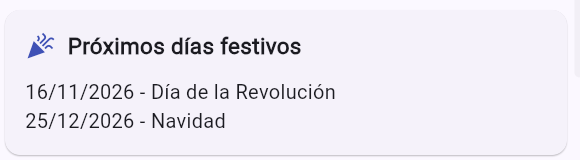
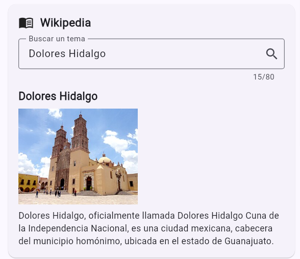

### Prueba 1. Validación del cliente HTTP seguro
Se realizaron pruebas automatizadas para verificar el uso obligatorio de HTTPS, el manejo de errores de conexión, la validación de respuestas JSON, los límites de tiempo y tamaño, y la protección de claves privadas en las URLs.
[Pantallas](screenshots/01_cliente_seguro.png)

[Pantallas](screenshots/02_cinco_apis.png)

[Pantallas](screenshots/03_seguridad.png)

[Pantallas](screenshots/04_viewmodel.png)

[Pantallas](screenshots/05_pruebas_completas.png)

### Prueba 6. Consumo de la API Open-Meteo
Se comprobó que la aplicación consulta la API Open-Meteo para obtener y mostrar información meteorológica de Dolores Hidalgo, incluyendo la temperatura y las condiciones del clima.
[Pantallas](screenshots/06_api_clima..png)

### Prueba 7. Consumo de la API Frankfurter
Se comprobó que la aplicación Dolores Hoy consulta correctamente la API Frankfurter para obtener información del tipo de cambio y mostrar la equivalencia del dólar estadounidense y el euro en pesos mexicanos.
[Pantallas](screenshots/07_api_tipo_cambio.png)

### Prueba 8. Consumo de la API Nager.Date
Se comprobó que la aplicación Dolores Hoy consulta la API Nager.Date para obtener los próximos días festivos oficiales de México, mostrando sus nombres y fechas correspondientes.
[Pantallas](screenshots/08_api_festivos.png)

### Prueba 9. Consumo de la API Wikipedia
Se comprobó que la aplicación Dolores Hoy permite realizar búsquedas mediante la API de Wikipedia en español. Se utilizó como ejemplo el tema "Dolores Hidalgo", verificando que se muestra el título y un resumen de la información consultada.
[Pantallas](screenshots/09_api_wikipedia.png)

### Prueba 10. Consumo de la API NASA APOD
Se comprobó que la aplicación Dolores Hoy consulta correctamente la API NASA APOD para obtener información astronómica. Se verificó que muestra la fotografía, su título y la descripción correspondiente.
[Pantallas](screenshots/10_api_nasa.png)

