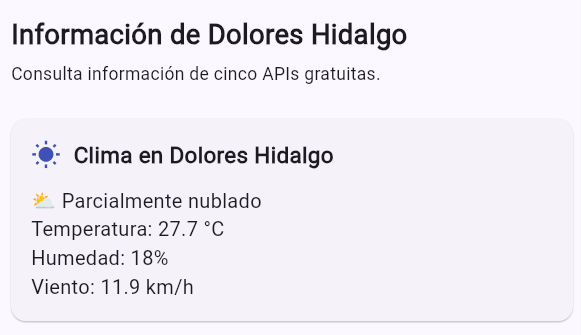
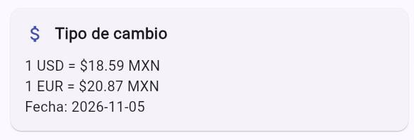
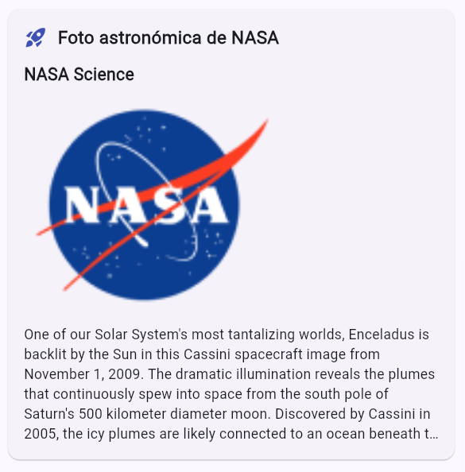

# 🌎 Dolores Hoy

## Descripción del proyecto

Dolores Hoy es una aplicación desarrollada con Flutter que permite consultar información de Dolores Hidalgo, Guanajuato, mediante el consumo de cinco APIs REST gratuitas.

La aplicación muestra información del clima, tipo de cambio, días festivos, Wikipedia y la fotografía astronómica del día proporcionada por NASA.

El proyecto fue desarrollado aplicando la metodología TDD (Test Driven Development) y buenas prácticas de seguridad informática.

## Objetivo

Desarrollar una aplicación Flutter que consuma cinco APIs externas, implemente pruebas automatizadas y aplique medidas de seguridad para proteger los datos y garantizar un funcionamiento confiable.

## Tecnologías utilizadas

- Flutter
- Dart
- HTTP y JSON
- APIs REST
- Visual Studio Code
- MockClient
- Pruebas TDD

## APIs utilizadas

### 1. Open-Meteo — Clima

Permite consultar el clima actual de Dolores Hidalgo.

Información mostrada:
- Temperatura en grados Celsius.
- Humedad.
- Velocidad del viento.
- Condiciones climáticas.

### 2. Frankfurter — Tipo de cambio

Permite consultar el tipo de cambio del peso mexicano frente al dólar estadounidense y al euro.

Información mostrada:
- Precio de un dólar en pesos mexicanos.
- Precio de un euro en pesos mexicanos.
- Fecha de actualización.

### 3. Nager.Date — Días festivos

Consulta los días festivos oficiales de México.

Información mostrada:
- Nombre del día festivo.
- Fecha de celebración.
- Próximos días festivos del año.

### 4. Wikipedia — Información

Permite buscar información de un tema utilizando Wikipedia en español.

Características:
- Búsqueda mediante texto.
- Visualización del título.
- Resumen del artículo.
- Imagen, cuando está disponible.

### 5. NASA — Foto astronómica

Consulta la fotografía astronómica del día mediante NASA APOD.

Información mostrada:
- Título.
- Fotografía astronómica.
- Descripción.
- Fecha de publicación.

## Medidas de seguridad

